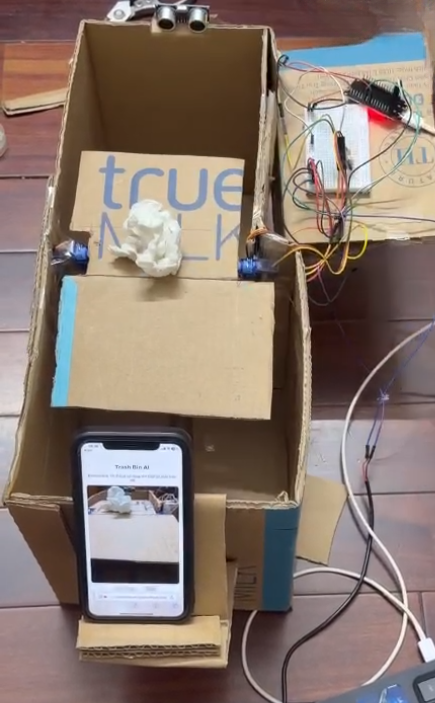
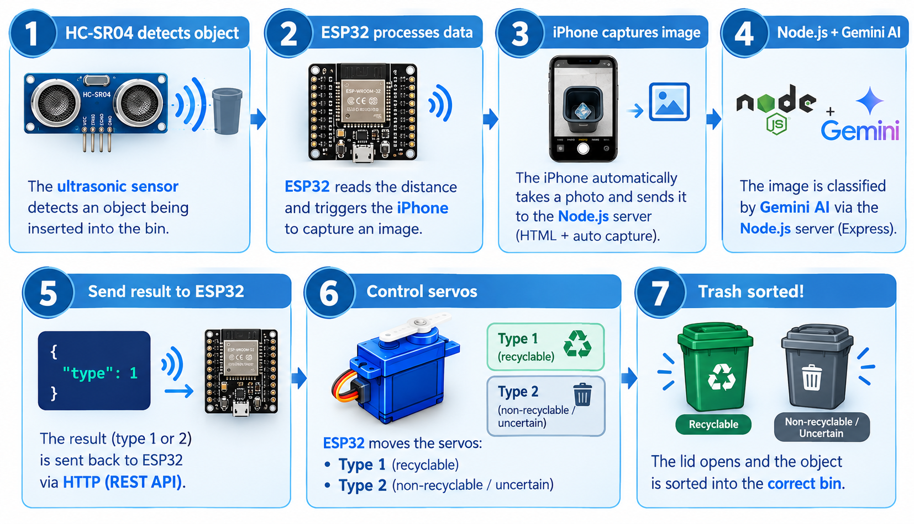
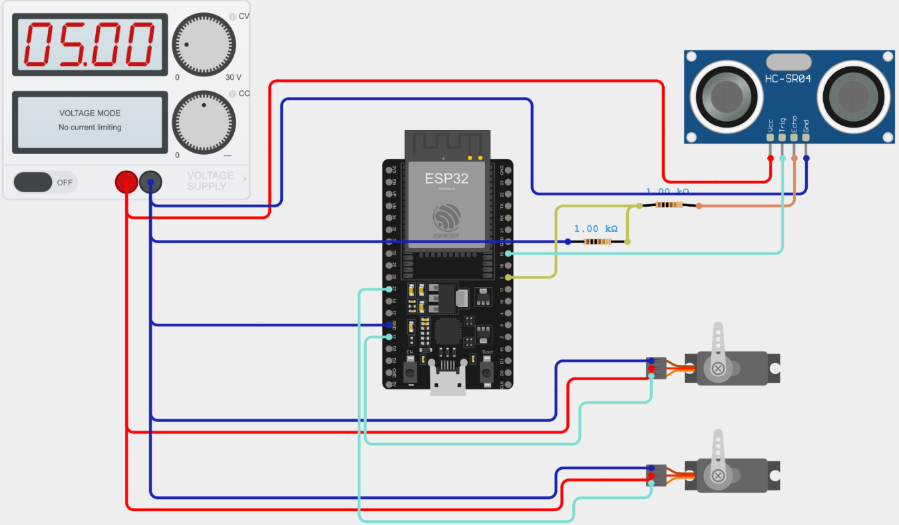
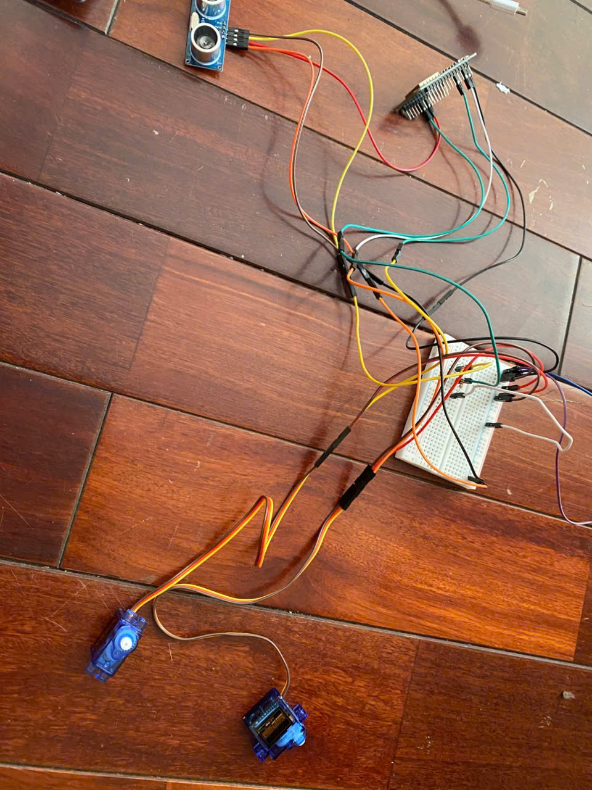

# AI Smart Trash Bin

An independent project combining embedded systems, computer vision, and AI-powered waste classification.

## Demonstration

[Watch Project Demonstration](https://github.com/ngockhoi2009/AI-Smart-Trash-Bin/issues/new)

## Overview

This prototype explores how AI can interact with physical devices to automate waste sorting. It combines an ESP32, an ultrasonic sensor, an iPhone camera interface, and servo motors.

## How It Works

1. **Detection:** HC-SR04 detects an object.
2. **Image Capture:** ESP32 initiates image capture through an iPhone.
3. **Classification:** A Node.js server sends the image to Google Gemini API.
4. **Sorting:** ESP32 receives the result and controls two servo motors.

## Hardware & Technologies

- **Hardware:** ESP32, HC-SR04, 2 SG90 servo motors
- **Backend:** Node.js, Express.js
- **AI:** Google Gemini API
- **Languages:** C++, JavaScript, HTML
- **Communication:** HTTP, JSON

## Circuit Design

## Development Journey

**Starting Out**

[Briefly explain why you wanted to build this project and what inspired the idea.]

**Making It Work**

[Describe one interesting challenge when connecting the ESP32, iPhone, and Node.js server.]

**Testing & Improvements**

[Mention one actual bug you encountered and how you figured out the solution.]

## Source Code

- [Arduino Firmware – IoTBin.ino](IoTBin.ino)
- [Node.js Backend – Server.js](Server.js)
- [Camera Interface – Web.html](Web.html)

## What I Learned

- Integrating hardware and software into one system.
- Connecting AI services with embedded devices.
- Debugging and testing a multidisciplinary project.

## AI Assistance

I independently implemented the firmware and backend, while using AI assistance to understand unfamiliar concepts and troubleshoot parts of the implementation. I tested and refined the code throughout development.

---

*An independent hands-on project exploring applied AI and embedded systems.*
