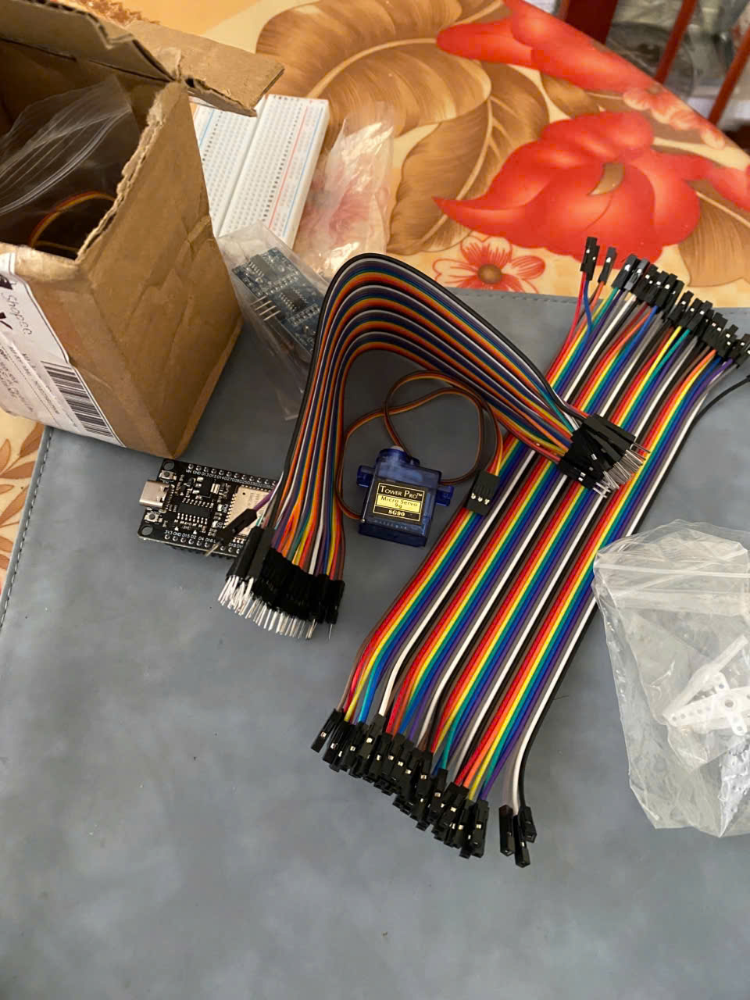
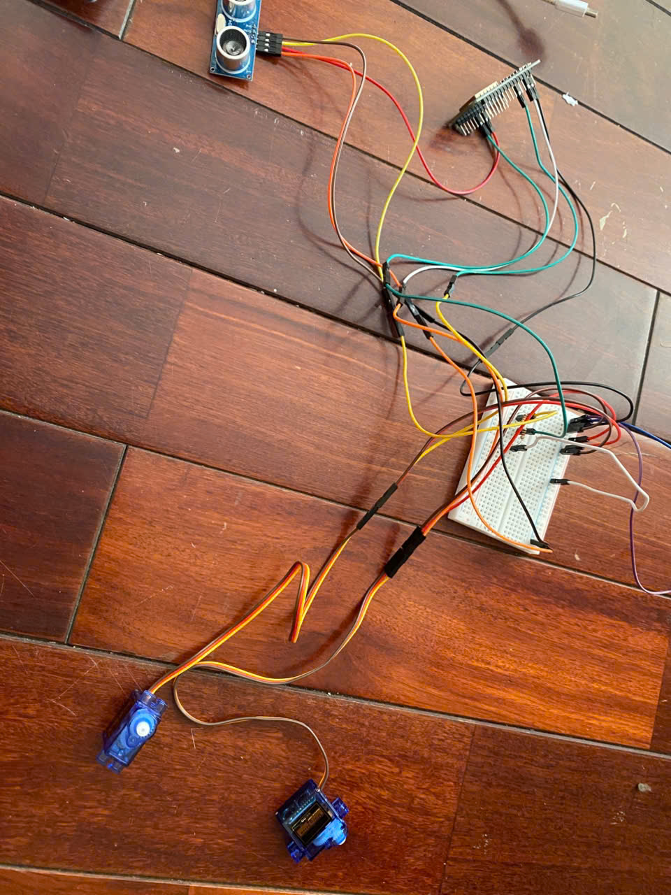

## Demonstration

[*Video demonstration of the working prototype.*]
(https://drive.google.com/file/d/1eQrgix22_SPGAshmd_g9ONcijUHg3q8C/view?usp=sharing)

## Project Gallery

## Source Code

- Arduino Firmware (C++): ESP32 sensor control, HTTP communication, and servo operation.
- Node.js Backend: Server-side processing and AI-powered waste classification.
- HTML Camera Interface: iPhone camera interface for image capture and submission.
Code links will be added to each component.

## Key Learning Outcomes

- Integrating electronic components into a working prototype
- Connecting hardware with an AI-powered workflow
- Exploring the interaction between software decisions and physical actions
- Testing and troubleshooting a multidisciplinary engineering project

## Development Process & AI Assistance

I independently implemented the Arduino firmware and developed the Node.js backend, using AI assistance mainly for HTTP communication and JSON handling. Throughout the project, I tested and refined the code to ensure reliable communication between the ESP32 and the server. I am continuing to study these concepts to strengthen my understanding and gradually improve my ability to implement the system independently.

---

*An independent hands-on project exploring applied AI and embedded systems.*# AI-Smart-Trash-Bin-Copy
An ESP32-based smart waste-sorting prototype integrating sensors, image capture, AI classification, and servo control.
